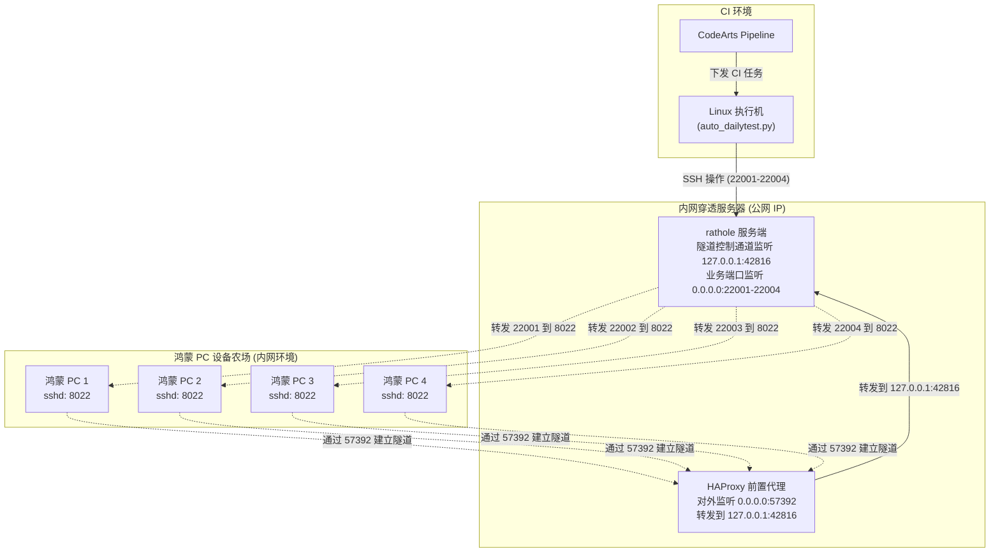

# 设备农场部署指南

## 1 方案简介

在 Harmonybrew 项目中，有一条 [auto_dailytest](https://atomgit.com/Harmonybrew/ci/blob/main/src/auto_dailytest.py) 流水线。这条流水线会每天在鸿蒙 PC 真机上测试当天更新过的 formula。

由于厂商并未提供云化的鸿蒙 PC 环境，当前我们通过设备农场的方式来处理测试设备的问题。

整体的方案是这样的：

- CodeArts Pipeline 平台将 CI 任务下发到 Linux 执行机，Linux 执行机会执行 auto_dailytest.py 脚本。
- 在 auto_dailytest.py 脚本中，我们通过 ssh 命令去操作鸿蒙 PC，执行 `brew test` 等命令。
- 由于鸿蒙 PC 没有公网 IP，因此鸿蒙 PC 的 ssh 端口需要通过内网穿透工具来暴露给 Linux 执行机。



## 2 前置准备

### 2.1 准备设备

需要准备如下设备：

- 带有公网 IP 的 Linux 服务器（作为内网穿透服务器）
- 鸿蒙 PC 真机，多台（作为执行机）

### 2.2 规划端口

准备好设备后，需要规划端口映射关系，比如这样：

| 鸿蒙 PC | sshd 端口 | 内网穿透服务器端口 |
| ------- | --------- | ------------------ |
| pc_1    | 8022      | 22001              |
| pc_2    | 8022      | 22002              |
| pc_3    | 8022      | 22003              |
| pc_4    | 8022      | 22004              |

### 2.3 放通安全组

修改内网穿透服务器的安全组，放通 57392 和 22001~22004 端口。若客户端公网出口 IP 固定，建议仅对客户端公网出口 IP 放通；出口 IP 不固定时对 0.0.0.0 放通。

## 3 配置内网穿透服务器

### 3.1 配置 rathole

首先需要在 Linux 服务器上下载 rathole

```sh
mkdir -p /opt/rathole/bin

# x86 服务器下载 rathole-x86_64-unknown-linux-gnu.zip
curl -LO https://github.com/rathole-org/rathole/releases/download/v0.5.0/rathole-x86_64-unknown-linux-gnu.zip
unzip rathole-x86_64-unknown-linux-gnu.zip
mv rathole /opt/rathole/bin/rathole
rm rathole-x86_64-unknown-linux-gnu.zip

# arm 服务器下载 rathole-aarch64-unknown-linux-musl.zip（这个版本静态链接了 musl，它在 GNU 发行版上也能运行）
curl -LO https://github.com/rathole-org/rathole/releases/download/v0.5.0/rathole-aarch64-unknown-linux-musl.zip
unzip rathole-aarch64-unknown-linux-musl.zip
mv rathole /opt/rathole/bin/rathole
rm rathole-aarch64-unknown-linux-musl.zip
```

为 Noise Protocol 生成一对 X25519 密钥

```sh
/opt/rathole/bin/rathole --genkey
```

创建 rathole 配置文件 `/opt/rathole/server.toml`

```ini
[server]
bind_addr = "127.0.0.1:42816"

[server.transport]
# 启用 Noise Protocol
type = "noise"

[server.transport.noise]
# 上面 `rathole --genkey` 生成的 Private Key
local_private_key = "your_server_private_key_here"

[server.services.pc_1]
# token 用 openssl rand -hex 16 生成，不同 service 各不相同
token = "your_secure_token_here"
# 需要对公网暴露的端口
bind_addr = "0.0.0.0:22001"

[server.services.pc_2]
token = "your_secure_token_here"
bind_addr = "0.0.0.0:22002"

[server.services.pc_3]
token = "your_secure_token_here"
bind_addr = "0.0.0.0:22003"

[server.services.pc_4]
token = "your_secure_token_here"
bind_addr = "0.0.0.0:22004"
```

创建 rathole 专属用户，将相关文件分配给这个用户（权限最小化原则）

```sh
useradd -r -s /bin/false rathole
chown -R rathole:rathole /opt/rathole
```

创建 systemd 配置文件 `/etc/systemd/system/rathole.service`

```ini
[Unit]
Description=Rathole Server
After=network.target

[Service]
Type=simple
User=rathole
Group=rathole
WorkingDirectory=/opt/rathole
ExecStart=/opt/rathole/bin/rathole -s /opt/rathole/server.toml
Restart=on-failure
RestartSec=10
StandardOutput=journal
StandardError=journal
SyslogIdentifier=rathole
LimitNOFILE=65536
TasksMax=256
LimitCORE=0

[Install]
WantedBy=multi-user.target
```

启动 rathole 服务端

```sh
systemctl daemon-reload
systemctl enable rathole.service
systemctl start rathole.service
```

### 3.2 配置 HAProxy

安装 HAProxy

```sh
apt install -y haproxy
```

在 `/etc/haproxy/haproxy.cfg` 末尾追加

```ini
# ==== rathole 前置代理（防握手层洪泛）====
frontend rathole_in
	bind *:57392
	mode tcp
	log global
	option tcplog
	# 控制通道靠应用层心跳（30s）保活，超时设 1h 更保险，不用 defaults 的 50s
	timeout client 1h
	# 每 IP 限速：60 秒内超过 20 个新连接则拒绝
	stick-table type ip size 1m expire 60s store conn_rate(60s)
	tcp-request connection track-sc0 src
	tcp-request connection reject if { sc0_conn_rate gt 20 }
	# 2 秒内未收满完整 Noise 握手首包（≥48 字节）则拒绝
	tcp-request inspect-delay 2s
	tcp-request content accept if { req_len ge 48 }
	tcp-request content reject
	default_backend rathole_back

backend rathole_back
	mode tcp
	timeout connect 5s
	timeout server 1h
	server rathole 127.0.0.1:42816
```

启动 HAProxy

```sh
systemctl enable haproxy
systemctl restart haproxy
```

### 3.3 配置 Fail2ban

在 HAProxy 前置代理所在的内网穿透服务器上启用 Fail2ban，对被代理层反复拒绝的来源 IP（洪泛/探测）自动封禁。

安装 Fail2ban

```sh
apt install -y fail2ban
```

创建过滤器 `/etc/fail2ban/filter.d/haproxy-rathole.conf`

```ini
[Definition]
# 被代理层拒绝的连接（tcp-request reject），终止状态 PR，带真实客户端 IP
failregex = ^.*haproxy\[\d+\]: <HOST>:\d+ \[[^\]]*\] rathole_in \S+ -\d+/-\d+/\d+ \d+ PR .*$
ignoreregex =
```

创建 jail 配置 `/etc/fail2ban/jail.d/haproxy-rathole.local`

```ini
[haproxy-rathole]
enabled = true
backend = auto
logpath = /var/log/haproxy.log
filter = haproxy-rathole
# 1 小时内被代理层拒绝 5 次即封禁 1 天（洪泛/探测源）
maxretry = 5
findtime = 1h
bantime = 1d
```

启动 Fail2ban

```sh
systemctl enable fail2ban
systemctl restart fail2ban
```

## 4 配置鸿蒙 PC

### 4.1 打开安全开关

进入“设置” -> “系统” -> “开发者选项”，打开“开发者选项”开关。

进入“设置” -> “隐私和安全” -> “高级”，打开“运行来自非应用市场的扩展程序”开关。

> 如果你的系统不显示“开发者选项”菜单，则需要通过隐藏开关来开启：打开“设置” -> “关于本机”（即进入“设置”时的默认界面），找到“软件版本”，连续点击 7 次，出现弹窗后点击“确认重启并开启”即可。

### 4.2 下载工具

下载 openssh

```sh
cd ~
curl -fLO https://github.com/Harmonybrew/ohos-openssh/releases/download/10.4p1/openssh-10.4p1-ohos-arm64.tar.gz
tar -zxf openssh-10.4p1-ohos-arm64.tar.gz
rm openssh-10.4p1-ohos-arm64.tar.gz
```

> openssh 必须放在家目录下，因为编译时设置的 prefix 就是 `/storage/Users/currentUser`，放置到其他目录它将无法正常工作。

下载 rathole

```sh
cd ~
curl -LO https://harmonybrew.atomgit.com/api/formula.jws.json
RATHOLE_BOTTLE=$(cat formula.jws.json | grep -oE 'rathole-[0-9\._]+\.arm64_ohos\.bottle(\.[0-9]+)?\.tar\.gz')
curl -LO "https://harmonybrew.atomgit.com/bottles/$RATHOLE_BOTTLE"
tar -zxf $RATHOLE_BOTTLE
rm formula.jws.json $RATHOLE_BOTTLE
```

### 4.3 准备配置文件

准备一份 rathole 的配置文件 `~/rathole/client.toml`

```ini
[client]
# 云服务器的公网 IP 和 rathole 通信端口（1.2.3.4 替换为实际 IP）
remote_addr = "1.2.3.4:57392"

[client.transport]
# 启用 Noise Protocol，必须与服务端一致
type = "noise"

[client.transport.noise]
# 服务端 `rathole --genkey` 生成的 Public Key
remote_public_key = "your_server_public_key_here"

[client.services.pc_1]
# token 必须与服务端一致
token = "your_secure_token_here"
# 本机的 sshd 端口
local_addr = "127.0.0.1:8022"
```

> 不同执行机的配置文件内容不一样。比如服务名称，分别是 `pc_1`、`pc_2`、`pc_3`、`pc_4`。此外 token 也各不相同。

### 4.4 启动服务

启动 sshd

```sh
~/openssh-10.4p1-ohos-arm64/sbin/sshd -p 8022
```

启动 rathole

```sh
cd ~/rathole
nohup ~/rathole/0.5.0/bin/rathole -c ~/rathole/client.toml &
cd ~
```

> 如果要停止服务，可以用 pkill 命令：`pkill sshd && pkill rathole`。

### 4.5 配置 ssh 公钥

将 Linux 执行机的 ssh 公钥添加到鸿蒙 PC 上的 `~/.ssh/authorized_keys` 文件中

```sh
mkdir -p ~/.ssh && echo "ssh-ed25519 AAAA..." >> ~/.ssh/authorized_keys
```
